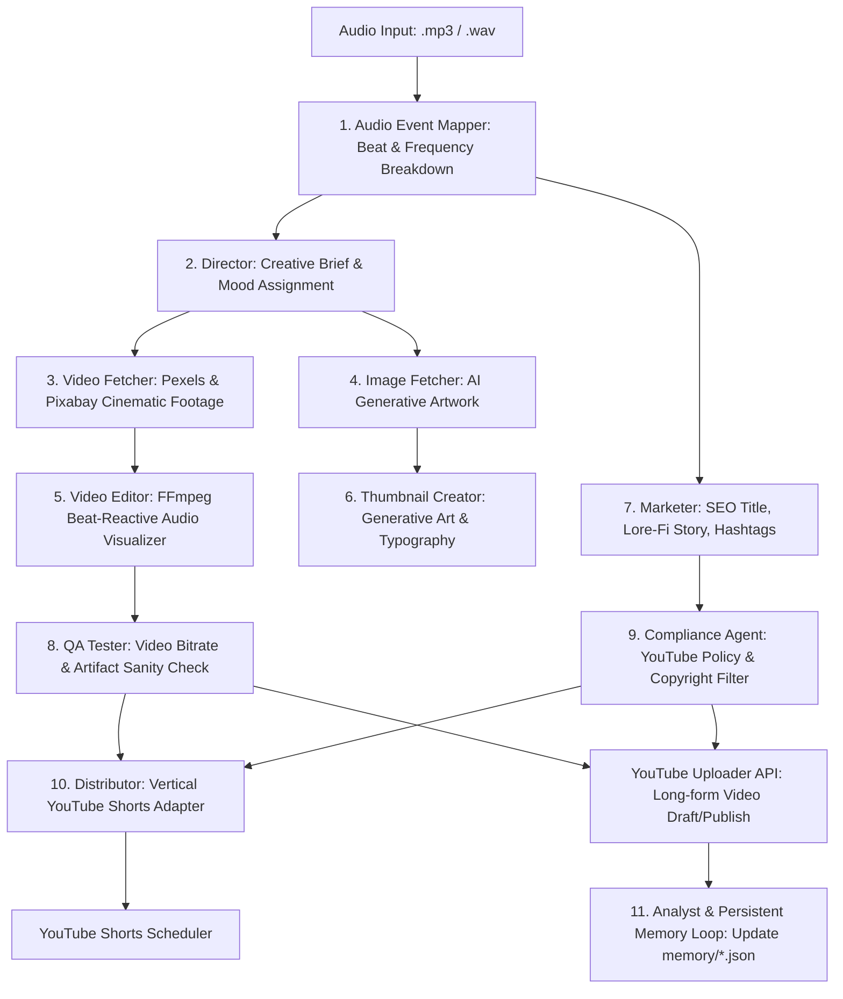

<h1 align="center">🎵 Lo-Fi Music & Video Automation Factory</h1>

<p align="center">
  <strong>Autonomous Multi-Agent Media Pipeline & YouTube Publishing Suite</strong><br>
  <em>Transforms raw audio into fully produced videos with beat-reactive visualizers, AI thumbnails, SEO metadata, and YouTube Shorts.</em>
</p>

<p align="center">
  
  
  
  
  
  
</p>

---

## ⚡ Overview

**Lo-Fi Automation** is a production-grade multi-agent media production engine. Operating without manual intervention, it watches incoming audio releases, analyzes acoustic features, directs visual themes, assembles cinematic videos via FFmpeg, generates branded thumbnails, composes algorithmic SEO copy, and publishes directly to YouTube (both long-form and Shorts) with real-time Telegram and Discord notifications.

---

## 🤖 The 11 Autonomous Agents



---

## 🏆 Key Features

- **🧠 Multi-Provider LLM Key Rotator**: Thread-safe key pool across Gemini, Groq (Llama 3.3 70B & 3.1 8B), and Cerebras to guarantee 100% uptime without hitting rate limits.
- **🎛️ Audio-Reactive FFmpeg Graphics**: Dynamic waveform, frequency bars, and atmospheric film grain filters timed to beat drops and tempo shifts.
- **🔁 Self-Improving Persistent Memory**: Agent decisions, performance metrics, and compliance heuristics are saved into `memory/*.json` and version-controlled, improving output consistency after every run.
- **📱 Automated Shorts Factory**: Automatically crops, reframes, and highlights peak chorus segments into 9:16 vertical shorts.
- **🔔 Live Ops Integration**: Status alerts, upload previews, and error logs broadcast immediately to Telegram and Discord.

---

## 🚀 Getting Started

### Prerequisites
- Python 3.10+
- FFmpeg installed (`brew install ffmpeg` on macOS, or `sudo apt install ffmpeg` on Linux)
- YouTube API credentials (see [youtube_setup_guide.md](youtube_setup_guide.md))

### Installation & Run

```bash
# Clone the repository
git clone https://github.com/thegalaxylegend/lofi-automation.git
cd lofi-automation

# Install Python requirements
pip install -r requirements.txt

# Configure environment variables
cp .env.example .env
# Edit .env with your Gemini, Groq, Pexels, and YouTube credentials

# Process a song through the multi-agent factory
python main.py audio/sample_track.mp3
```

---

## 📁 Repository Layout

```
lofi-automation/
├── agents/             # The 11 autonomous agent implementations
│   ├── director.py     # Creative direction & mood analysis
│   ├── video_editor.py # FFmpeg composition engine
│   ├── marketer.py     # SEO & storytelling generator
│   └── ...
├── core/               # Shared engine services
│   ├── api_rotation.py # Multi-LLM provider failover manager
│   ├── audio_analyzer.py # Librosa acoustic feature extraction
│   └── youtube_uploader.py # OAuth2 YouTube API client
├── memory/             # Persistent JSON state and learned heuristics
├── .github/workflows/  # CI/CD autonomous pipeline triggers
└── main.py             # Pipeline orchestrator
```

---

## 📄 License

Distributed under the **MIT License**.

<p align="center">
  Crafted with ❤️ by <strong>Ayush Kumar</strong> &bull; <a href="https://github.com/thegalaxylegend">Legends Tech Studio</a>
</p>
